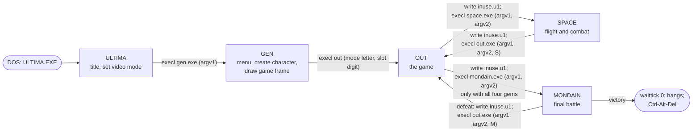
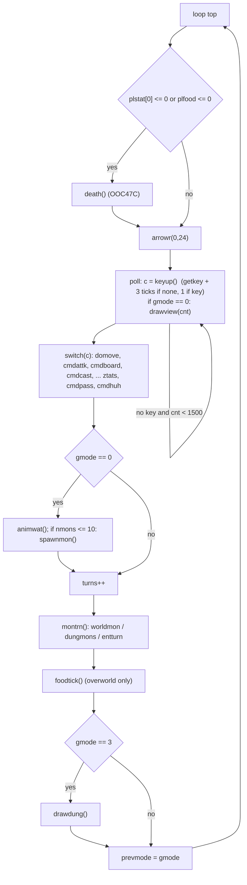

# Engine breakdown: Ultima I: The First Age of Darkness (PC, Origin 1986/87)

How the PC conversion of Ultima I (John Fachini, Origin Systems) works as a program: the five
executables and how they hand control and state to one another, the memory model, the main loops
and what drives time, and Origin's support library as the engine layer underneath the game code.
Everything here is read from the decompilation in this repository, which rebuilds all five
executables byte for byte ([../README.md](../README.md), [HANDOFF.md](HANDOFF.md)).

This document sits on top of the existing docs and does not repeat them:

| topic | where it is documented in detail |
|---|---|
| layout of every EXE (segments, module order, addresses) | [MAP.md](MAP.md) |
| how Lattice C 3.10 code reads, matching tricks | [MATCHING.md](MATCHING.md), [AGENT_BRIEF.md](AGENT_BRIEF.md) |
| readable names, the 8-character rule, `names.tsv` | [NAMES.md](NAMES.md) |
| programs, command lines, data files (top-level map) | [game/overview.md](game/overview.md) |
| ULTIMA.EXE title and loader | [game/title-and-loader.md](game/title-and-loader.md) |
| Origin video/keyboard/timer/sound/file routines as OUT uses them | [game/video-sound-input.md](game/video-sound-input.md) |
| the 820-byte character record | [game/save-format.md](game/save-format.md) |
| OUT's DGROUP, BSS addresses, screens | [game/out-state.md](game/out-state.md) |
| overworld, MAP.BIN, TCD.BIN, places | [game/world-and-map.md](game/world-and-map.md) |
| SPACE.EXE | [game/space-flight.md](game/space-flight.md) |
| mechanics (combat, monsters, dungeons, towns, quests, commands, GEN, MONDAIN) | the other files in [game/](game/) |

**Conventions.** Functions and globals are cited by their readable names (the names in the
current sources, applied from [names.tsv](names.tsv)); the `docs/game/` files still use the old
address names (`F_xxxx` = code offset, `D_xxxx` = DGROUP offset), and `names.tsv` maps one to the
other. A code address is the offset in the EXE named (for a shared Origin or Lattice module, the
address in the EXE whose number the module file carries, usually GEN). "DGROUP xxxx" is an offset
in that EXE's data group. Statements read from the code are given with file and function;
interpretations are marked **(inferred)**; facts that do not come from this repository are marked
**(outside knowledge)**.

---

## Contents

1. Program structure & build
2. Boot & initialization
3. Main loop & timing
4. Core data structures & memory layout
5. World representation
6. Rendering
7. Input
8. Sound & music
9. File I/O, data formats & saving
10. Scripting / conversation engine
11. AI, schedules & pathfinding
12. Rules-engine implementation
13. Memory management & overlays
14. Random number generator
15. Copy protection & platform specifics
16. Lineage
17. Open questions / unverified

### The engine at a glance

| aspect | Ultima I PC |
|---|---|
| executables | five DOS EXEs that replace each other in memory (ULTIMA, GEN, OUT, SPACE, MONDAIN) |
| language | K&R C (Lattice C 3.10, small model) for all game code; assembly for most of Origin's library |
| memory model | small: one code segment and one 64 KB data group per program; no far data, no EMS/XMS, no overlays inside a program |
| program switch | Lattice `execl`, implemented as an in-place overlay load (DOS INT 21h AX=4B03h from a relocated loader): the next program takes over the same PSP and memory block |
| state between programs | command line (video letter, slot digit, return flag), the 820-byte record in `inuse.u1`, the screen contents and video mode, and (Tandy) a reserved 16 KB block |
| time | turn-based and key-driven in OUT and MONDAIN; SPACE advances its world on every keyboard poll; all waits through a BIOS timer hook (INT 1Ch, 18.2 Hz) or vertical retrace (port 3DAh); idle 1500 polls = Pass |
| video | CGA 320x200x4, EGA 320x200x16 (mode 0Dh), Tandy 320x200x16; one row-address table hides the layouts; text through the BIOS teletype in graphics mode |
| sound | PC speaker by toggling port 61h in busy loops (ten fixed effects) |
| files | raw binary dumps read whole; stdio underneath; any DOS error loops on "Insert Ultima I diskette" |
| scripting | none |
| protection | none in the game code; ULTIMA.EXE carries the inert remains of a 1989 loader envelope |

---

## 1. Program structure & build

### 1.1 The five programs

| EXE | size | role | game code (source) | game functions | code / DGROUP size |
|---|---|---|---|---|---|
| ULTIMA.EXE | 36880 | adapter and memory check, title, story, castle picture; sets the video mode; execs GEN | `src/ultima/ULTIMA.C`, 03E9-0E4D | 18 | code 3EC8, DGROUP C72C + stack (32 KB of it the castle picture buffer `castlbuf`) |
| GEN.EXE | 20112 | main menu, character creation, roster; draws the game frame; execs OUT | `src/gen/GEN.C`, 03E9-1948 | 29 | code 4254, DGROUP 0EC8 + stack |
| OUT.EXE | 69858 | the game: overworld, towns, castles, dungeons, shops, quests, death | `src/out/OUTA.C`, `OUTB.C`, `OUTC.C`, `OUTBSS.C` (+`OUTSYM.ASM`), 03E9-908B | 194 | code D480, DGROUP B23C + stack |
| SPACE.EXE | 39824 | space flight and space combat; execs OUT | `src/space/SPACE.C`, `SPACE5.C`, `SPBSS.C`, 03E9-3DED | about 90 | code 72C9, DGROUP 611A + stack |
| MONDAIN.EXE | 31650 | story screens, the arena fight against Mondain, ending picture; execs OUT on defeat | `src/mondain/MONDAIN.C`, 03E9-2230 | 75 | code 5969, DGROUP 49B8 + stack |

(Sizes from [MAP.md](MAP.md) and the EXE headers; function counts from the `INTEGRATION.md` files
and `names.tsv`.) All game code is readable C now: the "generated stand-ins" mentioned in the
README's status table and in the older parts of [HANDOFF.md](HANDOFF.md) were replaced by C for all
four programs (HANDOFF "Current task", item 2; `src/out/INTEGRATION.md`,
`src/space/INTEGRATION.md`, `src/mondain/INTEGRATION.md`). What remains assembly is Origin's
library (44 of 47 modules), the Lattice runtime (73 generated modules) and the startup `C.ASM`.

### 1.2 Layers

Every EXE is the same four-layer stack, linked statically:

```
 +-----------------------------------------------------------------------+
 | game code (C)            ULTIMA.C | GEN.C | OUTA/B/C.C | SPACE.C | MONDAIN.C
 |   main loop, commands, rules, AI, data tables of its own              |
 +-----------------------------------------------------------------------+
 | Origin support library (src/origin, 47 modules, "OR/OM/OS/OU/OO")     |
 |   upper tier, compiled C: status panel, Ztats, Ready, file read/write,|
 |     video init, key helpers, OUT's object table and map view, death   |
 |   lower tier, hand-written assembly: video primitives and blitters,   |
 |     BIOS text, keyboard, timer hook, PC speaker, RNG, adapter detect  |
 +-----------------------------------------------------------------------+
 | Lattice C 3.1x runtime (src/lclib): stdio, level-1 I/O, malloc pool,  |
 |   exec (XLOADER), exit, INT 24h hook, rand, long arithmetic, printf   |
 +-----------------------------------------------------------------------+
 | startup CXINIT (src/lattice/C.ASM): segments, args, env, heap, 8087   |
 +-----------------------------------------------------------------------+
 | DOS (INT 21h), BIOS (INT 10h video, data area), hardware ports        |
 |   (61h speaker, 3DAh status, 3C4h/3CEh EGA, 3D8h CGA mode)            |
 +-----------------------------------------------------------------------+
```

The game code calls the Origin library and, for files, exec and exit, the Lattice library
directly (`EXECL`, `EXIT`, `FOPEN`... in GEN and ULTIMA; OUT/SPACE/MONDAIN go through Origin's
`readfile`/`writfile`). The Origin library calls Lattice for its file I/O (`OM3E2F.ASM`: `FOPEN`,
`FREAD`, `FWRITE`, `FCLOSE`), which is why LINK took the Lattice modules in two passes in OUT,
SPACE and MONDAIN ([MAP.md](MAP.md), "LINK took the library modules in two passes").

### 1.3 Toolchain and compilation

* **Compiler**: Lattice C 3.10 (LC 3.10, LC1 3.11, LC2 3.10), options `-ms -v -w -cs` (small model,
  no stack probes, even frames, identical strings stored once), K&R C without prototypes
  (first line of every C file; [MATCHING.md](MATCHING.md)). Identifiers have 8 significant
  characters and externals are upper-cased ([NAMES.md](NAMES.md)), which is why `_stack` (OUT,
  MONDAIN) and `_STACK` (SPACE) are the same symbol.
* **Runtime**: a Lattice release between 3.00g and 3.30 (17-27 modules per EXE are byte-identical
  to 3.00g's LCS.LIB; others differ: FOPEN sets errno, the I/O modules changed). No copy of this
  release is known; the startup was rebuilt by hand ([HANDOFF.md](HANDOFF.md), "Toolchain facts").
* **Assembler**: MASM 3.00 (4.00 gives the same objects). **Linker**: Microsoft LINK 3.05 (2.40 and
  3.00 produce the same files). The header checksums are LINK's own.
* **Calling convention**: Lattice C pushes arguments right to left and restores SP from BP after
  every call (`mov sp,bp`); the assembly modules of the Origin library end in `RET n`, popping their
  own arguments (e.g. `waittick` `RET 2`, `drawship` `RET 8`, `drawtile` `RET 6`). The two conventions
  coexist only because the C caller re-derives SP from BP after each call, so the callee's pop is
  harmless **(inferred from the code shapes; it is how every call site in the C sources looks)**.
* **Module boundaries in the original**: OUT's game code was one C module of about 4700 lines in the
  original (345 string literals, none repeated, in order of first use across all functions:
  `src/out/INTEGRATION.md`); the rebuild splits it into three files only because LC1 runs out of
  memory at about 2250 lines. The developers' machine evidently compiled it in one piece
  **(inferred)**.

### 1.4 Link layout (all five EXEs)

Summarized from [MAP.md](MAP.md), "Common layout":

```
 code segment PROG (CS)                           DGROUP (DS = SS)
 +--------------------------+ 0000               +-----------------------------+ 0000
 | CXINIT (C.ASM, 03E9 b.)  |                    | startup data: segment table,|
 +--------------------------+ 03E9               |  argv/env, _OSERR (0071),   |
 | game code (C)            |                    |  abort messages     (0123)  |
 +--------------------------+                    +-----------------------------+ 0124
 | Lattice modules, pass 1  |                    | game DATA (_stack, literals)|
 +--------------------------+                    | Lattice DATA                |
 | Origin modules           |                    | Origin DATA (row table,     |
 |  (fixed library order)   |                    |  text tables, palettes)     |
 +--------------------------+                    +-----------------------------+
 | Lattice modules, pass 2  |                    | BSS: game, Origin; _IOB last|
 |  (file I/O for Origin)   |                    +-----------------------------+
 +--------------------------+                    | XSTACK 1400h (image size;   |
                                                 |  real stack = _stack bytes) |
                                                 +-----------------------------+
                                                 | env copy, heap (>= 2 KB),   |
                                                 |  all inside the 64 KB group |
                                                 +-----------------------------+
```

The header relocations (37-39 per EXE) are all segment references: the startup's DGROUP, UDATA,
XSTACK and FAR_BSS frames, ONERROR's code frame and the Origin interrupt handlers loading DGROUP
(e.g. `TIMERISR` in `OR3E5E.ASM`: `MOV AX,DGROUP`). There is no far data and `FAR_BSS` is empty.

### 1.5 Origin's support library as the engine

The library is linked as object modules that appear in the same relative order in every EXE that
uses them, which is why [MAP.md](MAP.md) could recover the module boundaries by comparing the five
EXEs. That points to one object library from which LINK pulls what each program references
**(inferred; no library file or name survives)**. Module files are named after their first routine
and the EXE they were first found in: OR = GEN (the original 17), OM = MONDAIN, OS = SPACE,
OU = ULTIMA, OO = OUT.

| module | routines (readable names) | role | tier | linked by |
|---|---|---|---|---|
| OR34BF | `detvid`, `gotoxy`, `modecga` | detect CGA/EGA/Tandy/PCjr, BIOS cursor, CGA mode 4 | asm | all |
| OR357C | `putch` | one character through BIOS teletype | asm | GE OU SP MO |
| OR3599 | `putstr`, `fillrect` | string through teletype; filled rectangle per adapter | asm | all |
| OR3862 | `upcase` | toupper | asm | all |
| OR387E | `arrowr`, `arrowl` | arrow glyphs over a text cell (prompt, headings) | **C** | GE OU SP MO |
| OR39C5 | `waitkey` | wait for a key with the blinking cursor | **C** | GE OU SP MO |
| OR39FC | `drawline`, `F_3A1D`, `penx`/`peny` | Bresenham line, pen position | asm | all |
| OR3AD7 | `gamefram` | the outer frame of the game screen | **C** | GE only |
| OR3C8B | `putnum` | unsigned number, padded | asm | GE OU SP MO |
| OR3D41 | `pixel`, `pixelpen`, `F_3D61`; `vidmode`, `vidmarg` | plot a pixel; the adapter globals | asm | all |
| OR3E5E | `waittick`, `F_3E77`, `TIMERISR` | wait n ticks through an INT 1Ch hook | asm | all |
| OR3EC4 | `clockrnd` | 12-bit value from the DOS time | asm | GE OU SP MO |
| OR3EED | `scrlmsg` | scroll the message area | asm | GE OU SP MO |
| OR3F62 | `playsnd`, `sndtab`, 10 sound routines | PC speaker effects 0-9 | asm | GE OU SP MO |
| OR4071 | `mkrowtab`, `rowtab` | 200-entry pixel-row address table | asm | all |
| OR09DA | `palette` | 16-colour palette (data only) | asm | all |
| OR40EE | `modetand`, `modeega` | Tandy mode 9, EGA mode 0Dh + palette | asm | all |
| OR413C | `getkey`, `drawcurs`, `flushkey`, `kbdsync`, `curglyph` | key poll with animated cursor; type-ahead flush | asm | all |
| OM33BB | `lowcase` | tolower | asm | OU MO |
| OM353A | `strlen2` | strlen | C frame | OU SP MO |
| OM355D | `drawtile`, `blittile` | 16x16 tile blitter per adapter | asm | OU MO |
| OM37FD | `seedrnd`, `lineto` | seed the RNG; line from the pen | asm | OU SP MO |
| OM3AE2 | `presskey` | "Press Space to continue:" | C frame | OU SP MO |
| OM3B46 | `msgline` | print a line in the message area and scroll | asm | OU SP MO |
| OM3BF6 | `botbar`, `topbar` | frame bars | asm | OU SP MO |
| OM3CF1 | `vwait` | wait n vertical retraces (port 3DAh) | asm | SP MO |
| OM3E2F | `readfile`, `writfile` | whole-file read/write, retry forever | C frame | OU SP MO |
| OM3F58 | `vidinit` | colours, row table, optional mode set | C frame | UL OU SP MO |
| OM3FF9 | `palnorm`, `palflash` | normal / flash palette | asm | MO |
| OM4069 | `rndrange`, `rndseed` | the game's RNG | asm | UL OU SP MO |
| OM40A8 | `isvowel`, `getlevel`, `quadrant`, `keyup`, `keywait` | small game helpers, key with delay | C frame | OU SP MO |
| OM418A | `drawhead`, `smallbar`, `pickitem`, `readycmd`, `readywpn/arm/spl` | headings, list boxes, the Ready command | C frame | OU MO |
| OM4437 | `showhp`, `showfood`, `showexp`, `showcoin`, `showstat`, `ztats`, ... + text tables | status panel, Ztats, and the name/message tables of the game | C frame + data | OU SP MO |
| OS5643 | `textmode` | back to BIOS text mode 3 (before an error exit) | asm | OU SP |
| OS603E | `drawship`, `drawfite` | XOR sprite blitters with collision flag | asm | SP |
| OS68F8 | `plotclip` | pixel through the viewport clip | asm | SP |
| OU3BD5 | `memcheck` | largest free block; Tandy 16 KB reservation | asm | UL |
| OU3C6C | `palcastl`, `palnorm`, `blittand`, `blitcga`, `cvtplane`, `blitega` | full-screen picture to screen per adapter | asm | UL |
| OOA363 | `terrain`, `mapcell`, `placeat`; `placex`/`placey` | MAP.BIN nibble lookup, place coordinates | asm | OU |
| OOA554 | `animwat` | rotate the water tile's pixels | asm | OU |
| OOAB9D | `drawtomb` | tombstone picture | asm | OU |
| OOAC91 | `drawdmon`, `unpackxy` + stroke tables | dungeon vector sprites scaled by depth | asm | OU |
| OOAF57 | `drawview`, `readnum`, `isdigch` | animated repaint of the overworld view; number entry | C frame | OU |
| OOB34F | `towntile` | 8x8 town tile blitter | asm | OU |
| OOB502 | `addmon`, `findmon`, `delmon`, `cntmon`, `cntveh`, `stepn/s/e/w`, `scrolln/s/e/w` | the overworld object table; world wrap; view scrolling | C frame | OU |
| OOC2AF | `objat`, `viewx`, `viewy`, `incview`, `drawbuf`, `drawwrld` | object-or-terrain lookup, view buffer, full view redraw | C frame | OU |
| OOC47C | `death` | death and resurrection | C frame | OU |

("C frame" = the module's routines have the Lattice frame `push bp; sub sp,N; mov bp,sp`, so they
were compiled C, kept as generated assembly; the three files with a `.C` extension are the ones
re-expressed as C so far. GE/UL/OU/SP/MO = GEN/ULTIMA/OUT/SPACE/MONDAIN; from the `.lnk` files.)

Three things make this library an engine layer rather than a generic toolkit:

* **It owns game logic and game data.** The status panel, the Ztats screen, the Ready command
  (`OM4437`, `OM418A`), the whole overworld object table and map view (`OOB502`, `OOC2AF`,
  `OOAF57`, `OOA363`), death and resurrection (`OOC47C`) and the tables of weapon, armour, spell,
  vehicle, monster, place and princess names, town entity templates, monster move chances, food
  periods and the dungeon perspective tables (DGROUP 267C-39E8 in OUT) all live in library modules,
  not in OUT's own code. OUT names the unlabelled tables by absolute address (`src/out/OUTSYM.ASM`:
  `placenam EQU 307CH`, `enttmpl EQU 31DCH`, ...).
* **It depends on a contract of game globals.** Library modules reference globals that each game
  program defines in its own BSS at its own address: the colours `colline`, `colfill`, `colhigh`,
  `coltext`, `forcecga`, the mode `gmode` and `redraw`, every field of the character record
  (`plname`, `plstat`, `plcoin`, ... `plkills`), `objtab`, `worldx`, `worldy`, `lastmon`, `tilegfx`
  (EXTRN lists of `OM4437.ASM`, `OOC47C.ASM`, `OOB502.ASM`, `OM355D.ASM`). The library is relinked
  against each program's addresses.
* **It calls back into the game.** `readfile`/`writfile` call `diskprmt` (each program's own
  "Insert Ultima I diskette" routine); `death` calls OUT's `rmregion` and `randhop`
  (`OOC47C.ASM`). These game routines are "shared" names in `names.tsv` for that reason.

A side effect of the module granularity: SPACE and MONDAIN link `OM4437` for the status panel and
Ztats, and with it carry OUT's place names, town templates and dungeon tables (about 5 KB of DGROUP)
that they never use **(inferred from the module's data extent; LINK cannot drop part of a module)**.

### 1.6 Memory model and load sizes

Small model throughout: CS = the program's single code segment (PROG), DS = SS = DGROUP, all
pointers near. Header values of the five EXEs (read with a scratch script from `gamedata/*.EXE`):

| EXE | load image | min alloc (BSS + stack) | entry CS:IP | stack SS:SP in header | memory needed (image + min alloc) |
|---|---|---|---|---|---|
| ULTIMA | 8E10 | 924 paragraphs | 088F:0000 (envelope stub) | 09E1:0064 (envelope) | about 72 KB + PSP |
| GEN | 4C90 | 18A | 0000:0000 | 0513:1400 | about 25 KB |
| OUT | 10EE2 | 8BE | 0000:0000 | 186C:1400 | about 102 KB |
| SPACE | 9990 | 4E6 | 0000:0000 | 0D3F:1400 | about 57 KB |
| MONDAIN | 79A2 | 3D9 | 0000:0000 | 0A33:1400 | about 45 KB |

All have max alloc FFFF; the startup gives memory back itself (section 2). OUT is the largest and
sets the memory floor of the game: ULTIMA refuses to run with less than 1900h paragraphs (100 KB)
free (`chkmem`, ULTIMA.C), a margin that covers OUT's 19ADh (about 6.6K) paragraphs once ULTIMA's own block is
reused by the exec (section 13) **(inferred: the check compares only the largest free block, not
the sum)**.

The stack is not the 1400h-byte XSTACK segment of the image: CXINIT sizes it from the `_stack`
variable (at least 2 KB; `C.ASM`, label M5). OUT and MONDAIN define their own (`int _stack = 3072`,
OUTA.C; `int _stack = 3000`, MONDAIN.C), SPACE `int _STACK = 0x800` (SPACE.C), GEN and ULTIMA take
the library's 0800h (`src/lclib/STACK.ASM`). Above the stack follow the environment copy (at least
1 KB) and the heap (at least 2 KB, `_MNEED` = 0), and CXINIT aborts with "Insufficient memory"
unless DGROUP, stack, environment and heap fit in 1000h paragraphs (`C.ASM`:
`SUB BX,D_002A; CMP BX,1000H`). The heap holds only the stdio buffers (BUFSIZ = 200h,
`src/lclib/BUFSIZ.ASM`) and the environment block that `doexec` builds before an exec; the game
never allocates.

The memory map of OUT's DGROUP (offsets from [game/out-state.md](game/out-state.md), MAP.md and
`OUTBSS.C`):

```
DGROUP (OUT.EXE, paragraph 0D48 of the image)
0000  CXINIT data: segment table, _PSP, _ENV, _ARGV, _OSERR(0071), abort strings
0124  game DATA: _stack=3072, tilefile[], "playerx.u1", 345 message literals, spawnthr (16CC)
17A4  Lattice DATA (randseed = 1 for rand(), _iob modes, malloc pool variables, errno table)
18B0  Origin DATA: "Tandy", fill variables, placex/placey (18C8/191C), tomb masks (19EC),
      dungeon sprite strokes (2480), placeval, "rb"/"wb", rowtab[200] (24EC),
      rndseed (267C), Ready/Ztats strings, weapon/armour/spell/vehicle/race/class names,
      strtab, place names (307C), entity templates (31DC), monster/food/monument tables,
      dirtab + perspective tables (37D4-3860), dungeon monster names, palettes, cursor glyphs
3A56  Lattice DATA (second pass)
3A70  BSS  colline colfill colhigh coltext
3A78       the character record, 820 bytes (to 3DAC)           <- the only state that travels
3DAC       mapbin: MAP.BIN, 13104 bytes (168 x 156 nibbles)
70DC       tilegfx: overworld tiles, 6656 bytes (52 x 128; CGA uses 3328)
8ADC       viewbuf: 19 x 9 view buffer (171 bytes)
8B88       argv1..3, counters, gmode (8B9A), turns (8BA8, long), forcecga
8BAE       tcdbin: TCD.BIN, 10 maps x 38 x 18 (to A666)
A666       town tiles (*TOWN.BIN, 1632 bytes, loaded by absolute address)
ACC6       ents[15]; town/dungeon variables (AD3E-AD54)
AD56       dungmap[11][11] of struct cell (968 bytes); dmontype (B11E)
B124  _IOB (20 FILEs, Lattice)
B240  XSTACK: stack 3072 bytes, then environment copy, then heap (>= 2 KB)
```

### 1.7 The build artefacts per program

| program | link file | notes |
|---|---|---|
| GEN | `src/gen/gen.lnk` | the only program without the second Lattice pass: its game code uses stdio directly |
| ULTIMA | `src/ultima/ultima.lnk` + `postlink.py` | links printf (`_PFMT`, `LU1222`), ctype and number conversions; the envelope remains are appended after LINK |
| OUT | `src/out/out.lnk` | three C parts + `OUTBSS.C` (all BSS as `char[]` in address order) + `OUTSYM.ASM` |
| SPACE | `src/space/space.lnk` | `SPACE5.C` is its own module only because its DATA starts word-aligned |
| MONDAIN | `src/mondain/mondain.lnk` | one C module |

---

## 2. Boot & initialization

### 2.1 From DOS to `main` (identical in all five)

`CXINIT` (`src/lattice/C.ASM`, code 0000, 1001 bytes, the same in every EXE):

1. DS = DGROUP, a temporary stack, save the PSP segment; turn the segment table at DGROUP 0012-003E
   into sizes.
2. DOS version (INT 21h AH=30h); DOS 1.x aborts with "Incompatible DOS version".
3. Clear UDATA (BSS) and FAR_BSS.
4. Scan the environment; under DOS 3 also take the program name that follows it.
5. Parse the command line for Lattice's `=stack/heap` sizes (an argument starting with `=`; never
   used by the game).
6. Size stack, environment section and heap; check that DGROUP fits in 64 KB; `RBRK` shrinks the
   program's memory block to what it needs (INT 21h AH=4Ah, `src/lclib/RBRK.ASM`). From here on the
   rest of conventional memory belongs to DOS again.
7. Split the command line into `argv` on the stack (quotes and backslash escapes honoured); copy the
   environment and build `environ`.
8. Probe for an 8087 (`FNINIT`/`FNSTSW`; `_NDP`), which nothing in the game uses.
9. `_MAIN` (`src/lclib/_MAIN.ASM`) sets up the five standard FILEs and calls `main(argc, argv,
   environ)`; if `main` returned, `EXIT(0)` (no program of the game returns from `main`).

Every `main` begins with `erron(1)`, Lattice's ONERROR set-up (`src/lclib/ONERROR.ASM`, routine at
1D0D in GEN): it installs `int24h` as the DOS critical-error handler. The handler records the error
and returns "fail" (AL = 3; "ignore" under DOS 2), so a missing disk or open drive door comes back
to the program as a DOS error in `_OSERR` instead of DOS's "Abort, Retry, Ignore". This is the
foundation of the "Insert Ultima I diskette" loops (section 9).

### 2.2 Per-program start-up

| program | sequence after `erron(1)` (function: file) |
|---|---|
| ULTIMA | `argv1 = argv[1]`; `forcecga = (upcase(argv[1][0]) == 'C')`; `chkvideo` (`detvid`; mono EGA: "Ultima I requires a Color Graphics Adapter." and `EXIT(1)`; `memcheck(1)` on Tandy, else `memcheck(0)`); `chkmem` (less than 1900h free paragraphs: "Not enough memory."); `drawbann` (calls **`vidinit(1)`: the only mode switch of the whole game**); `ldcastle` (CASTLE.4 or CASTLE.16 into `castlbuf`); on EGA `cvtplane` (repack the picture into four bit planes once); then the title loop. `main`: ULTIMA.C |
| GEN | `forcecga`; `ldnames` (scan player1..4.u1 for names); `setvid(0)` (GEN's own copy of `vidinit`, colours and row table only); `vidmarg = 0`; `drawbord`; menu loop. `main`: GEN.C |
| OUT | `forcecga`; keep `argv[1..3]`; `vidinit(0)`; `loadchar(argv[2][0])` (`playerN.u1`, or `inuse.u1` when `argv[3]` is set; a bad slot digit: `textmode()`, `EXIT(1)`); `loadgfx` (tiles); `readfile` MAP.BIN, TCD.BIN, the town tiles; restore `lastmon`/`turns` from the record; count objects; `seedrnd(plseed + clockrnd() % 999)`; dead record: `death()`, else `drawwrld()`; `showstat()`; command loop. `main`: OUTC.C |
| SPACE | `forcecga`; keep `argv[1..2]`; `vidinit(0)`; read `inuse.u1`, the Space and Fight sprite banks; `liftoff` (countdown); `mkgalaxy` (seeded from the record); reseed with the clock; `initstar`, `drawtop`; flight loop. `main`: SPACE.C |
| MONDAIN | `forcecga`; keep `argv[1..2]`; `vidinit(0)`; read `inuse.u1`, part of the overworld tile file and the Mond tiles into overlapping slots of `tilegfx`; `gmode = 5`; `showstat()`; `seedrnd(plseed + clockrnd())`; `storyrun`; `drawfld`; battle loop. `main`: MONDAIN.C |

Hardware detection happens in every program (`detvid` inside `vidinit`/`setvid`), but only ULTIMA
acts on it by switching the mode. GEN, OUT, SPACE and MONDAIN rely on the screen being in the right
graphics mode already, and the adapter letter in `argv[1]` only matters for forcing CGA. Started
directly from a DOS prompt (`OUT E 1`), OUT would draw into a text-mode screen **(inferred: no call
sets the mode in OUT)**.

### 2.3 The program chain



(Call sites: `credits` ULTIMA.C, `runout` GEN.C, `execveh` OUTA.C (from `cmdboard`), `toout`
SPACE.C, `defeat` MONDAIN.C. Argument details: [game/overview.md](game/overview.md) section 1.)

Properties of the chain that follow from the code:

* **There is no way back to DOS.** GEN's menu offers only "Generate new character" and "Continue
  previous game" (`mainmenu`, GEN.C); OUT's Quit saves and continues
  ([game/commands.md](game/commands.md)); MONDAIN's victory ends in `waittick(0)`, which never returns
  (section 3.5). The only `EXIT` calls are error exits (ULTIMA's adapter and memory checks, OUT's bad
  slot digit, SPACE's `abnormal`, SPACE5.C: "Abnormal program termination", `_EXIT(3)`).
* **Every `execl` sits in an endless retry loop.** If it returns (the file was not found) the
  program asks for the disk and tries again (`credits`, `runout` + `askdisk`, `execveh` + `diskprmt`,
  `toout` + `diskprmt`).
* **GEN passes `"out"` without an extension.** Lattice's `EXECVE` resolves it: `GETPF`
  (`src/lclib/GETPF.ASM`) tries the name as given, then with `COM`, then with `EXE` (strings at GEN
  DGROUP 0738/073C), using `GETFA` (get file attributes) to test each; there is no PATH search.
  ULTIMA, SPACE and MONDAIN name `gen.exe`/`out.exe` explicitly.

---

## 3. Main loop & timing

### 3.1 One loop skeleton, three programs

OUT, SPACE and MONDAIN share one loop shape, written out separately in each `main`:

```
for (;;) {
    [death check]
    arrowr(0, 24);                        /* the command prompt: an arrow at row 24 */
    n = 0;
    do {
        [per-poll work]                   /* OUT: drawview (animation) on the overworld
                                             SPACE: oneturn (the world moves!)
                                             MONDAIN: animate (tiles only) */
        c = [poll the keyboard, with a tick delay];
        n++;
    } while (c == 0 && n < 1500);
    if (c == 0) c = ' ';                  /* 1500 empty polls: the command is Pass */
    switch (c) { ...one case per command key... }
    [post-command processing]             /* OUT: animwat, spawn, turns++, montrn,
                                             foodtick, drawdung; MONDAIN: mondstat,
                                             mondturn; SPACE: redraw flags */
}
```

Sources: `main` in OUTC.C, SPACE.C, MONDAIN.C. GEN and ULTIMA have menu/sequence loops instead.

### 3.2 OUT: the turn loop



* Every key, valid or not, costs one turn (`turns` is incremented after the `switch`
  unconditionally; confirmed by running: [game/verification.md](game/verification.md)).
* `gmode` (DGROUP 8B9A) selects the sub-engine: 0 overworld, 1 town, 2 castle, 3 dungeon. There is
  no state machine object: each command function tests `gmode` itself (e.g. `cmdboard` refuses when
  `gmode != 0`, OUTA.C), and `montrn` (OUTC.C) dispatches the monsters' turn on it.
* A change of mode is noticed by comparing `gmode` with `prevmode` in the entity code
  (`entturn`, [game/towns-shops-castles.md](game/towns-shops-castles.md)).
* The order of events inside a turn is in [game/combat.md](game/combat.md) section 8 and
  [game/commands.md](game/commands.md) section 1.

### 3.3 SPACE: a world that moves while you think

`main` (SPACE.C) calls `oneturn()` **inside** the poll loop, before every key poll. In the top view
`oneturn` (SPACE.C) erases and redraws the player's ship sprite at its new position and handles
crashes and docking; in the front view it calls `fightfrm()`, which moves the star field, waits
`vwait(speeddly[speed])` vertical retraces (`speeddly = {0, 8, 7, 6, 5, 4, 3, 2, 1}`), moves the
enemy toward the crosshair, grows it, and lets it fire (`alienfir`). Commands only change velocity,
heading, speed or view. So SPACE is real-time in both views:

| view | per-poll pacing | rate **(inferred)** |
|---|---|---|
| top (`frontvw == 0`) | `waittick(2)` after every poll (`main`) | about 9 updates per second, set by the BIOS timer |
| front (`frontvw == 1`) | `vwait(speeddly[speed])` inside `fightfrm`, no tick wait | 8 retraces per frame at speed 1 down to 1 at speed 8, plus drawing time: CPU- and refresh-rate-dependent |

### 3.4 MONDAIN: turn-based with live animation

The battle loop (`main`, MONDAIN.C) animates on every poll (`animate`: the magic square, the gem,
Mondain's frames) but Mondain acts only after a command: `mondstat()` and `mondturn()` run after the
`switch`. `pollkey` (MONDAIN.C) waits 1 tick after a key, and 2 ticks plus either 1 more tick or
`vwait(4)` (while the gem bounces) when none came. The arena is therefore as turn-based as OUT; the
"real-time" impression of [game/final-battle.md](game/final-battle.md) comes from the animation and
from the 1500-poll auto-Pass, about four minutes **(inferred from the tick counts)**.

### 3.5 What drives time

There is no game clock. Four mechanisms produce every delay:

| mechanism | implementation | used for |
|---|---|---|
| **timer ticks** `waittick(n)` | `OR3E5E.ASM`: saves the INT 1Ch vector (INT 21h AH=35h), installs `TIMERISR` (increments `tickmax` and IRETs), spins until `tickmax >= tickcnt`, restores the vector. One tick = 1/18.2 s | key-poll pacing (`keyup`, `waitkey`, `pollkey`), SPACE's top view, every scripted pause (title, death count-up, story screens) |
| **vertical retrace** `vwait(n)` | `OM3CF1.ASM`: waits for bit 3 of port 3DAh to go high then low, n times | SPACE's front view frame rate, MONDAIN's gem animation |
| **busy polls** | `waitpoll` (OUT, OUTA.C) and `keypoll` (SPACE): up to 10000 `getkey(0)` calls; `keywait` (`OM40A8`): up to 1500 `keyup` calls (these do include tick waits); MONDAIN's `idlewait` (75000 polls) is never called | "press a key or wait" pauses after messages: **CPU-speed dependent** |
| **delay loops** | the ten sound routines (`OR3F62.ASM`) count down registers between speaker toggles; the title reveal (`revealpc`, ULTIMA.C) has no wait at all | pitch and length of every sound; speed of the title picture reveal: **CPU-speed dependent** |

Notes:

* The INT 1Ch hook is installed per call and removed afterwards, so no interrupt vector stays
  hooked while the program runs and none is left pointing into a program that `execl` is about to
  overwrite **(inferred as the design reason; the code certainly never leaves it hooked)**.
* `waittick(0)` never returns: the routine loops `OR AX,AX / JE` on its own argument before
  installing the hook (`OR3E5E.ASM`, 3E68). MONDAIN's `endgame` ends with
  `putstr("Press CONTROL-ALT-DEL to Restart")` and `waittick(0)` (MONDAIN.C), which is how the
  victory screen freezes. (This settles the "uncertain" idle in
  [game/final-battle.md](game/final-battle.md) section 5.)
* Overworld animation in OUT runs at the poll rate, about six repaints per second from the 3-tick
  idle delay of `keyup` plus the repaint time of `drawview`, so it is paced by the timer but slows
  down on a slow CPU **(inferred)**.
* The GOG configuration runs DOSBox at `cycles=500` on a `386_slow` core (`gamedata/dosboxULTIMA1.conf`),
  a throttle consistent with the CPU-dependent parts above **(inferred purpose)**.

---

## 4. Core data structures & memory layout

### 4.1 The global contract

Every program defines the same small set of globals that the Origin library expects (section 1.5);
their addresses differ per EXE ([game/overview.md](game/overview.md) section 4 has the table):

| global | meaning | set by |
|---|---|---|
| `vidmode` | 0 CGA, 1 EGA, 2 Tandy (-1 mono EGA) | `detvid` (OR34BF) |
| `vidmarg` | width in bytes of 8 pixels: 2 CGA, 1 EGA, 4 Tandy (the left margin of the map window) | `mkrowtab` (OR4071), mode setters |
| `rowtab[200]` | byte offset of each pixel row in video memory | `mkrowtab` |
| `colline`, `colfill`, `colhigh`, `coltext` | the four UI colours (CGA 3/2/1/3, EGA/Tandy 15/1/12/11) | `vidinit` (OM3F58) / GEN's `setvid` |
| `forcecga` | `argv[1]` starts with C | each `main` |
| `gmode`, `redraw` | sub-engine mode (OUT 0-3, MONDAIN 5); "redraw the header" flag | game code |
| `rndseed` | state of `rndrange` | `seedrnd` |
| the record fields `plname` ... `objtab` | the character | `readfile` of `inuse.u1`/`playerN.u1` |

### 4.2 The character record: the one persistent structure

All state that survives a program switch, a save or a restart is the 820-byte record (field table:
[game/save-format.md](game/save-format.md)). Every program reads it whole at start and writes it
whole before leaving, so it is also the inter-process message:

| program | record at | reads from | writes to |
|---|---|---|---|
| GEN | `plname` = DGROUP 0A30 | (names only, 15 bytes of each player file) | `playerN.u1` (new character; two `fwrite`s of B4h + 280h bytes) |
| OUT | 3A78 | `playerN.u1`, or `inuse.u1` when `argv[3]` | `playerN.u1` (`savegame`), `inuse.u1` (`execveh`) |
| SPACE | 5ADC | `inuse.u1` | `inuse.u1` (`toout`) |
| MONDAIN | 2058 | `inuse.u1` | `inuse.u1` (`defeat`; not on victory) |

What OUT keeps only in memory is lost at each exec and rebuilt from the record or from scratch on
return: the mode (always back to the overworld, `gmode = 0`), the town state, the dungeon level
(regenerated anyway), the food sub-counter (`foodcnt = 1`), the view buffer. OUT copies its two
non-record counters into the record before every write: `savlast = lastmon` and
`savturns = turns` (`execveh`, OUTA.C; `savegame`). Because the overworld object table `objtab`
(40 x 16 bytes, entry 0 = the player) is inside the record, the monsters and vehicles on the map
survive a trip to space, and a player who boarded a shuttle comes back still riding it
(`cmdboard` sets `objtab[0].type`, `plveh` and removes the vehicle object before `execveh`).

### 4.3 OUT's structures

Declared at the top of each OUT part (OUTA.C):

```c
struct mon  { int type, f2, x, y, f8, fa, fc, fe; };   /* objtab[40]: overworld objects (16 bytes)  */
struct ent  { int f0, f2, f4, f6; };                   /* ents[15]: town/castle entities {type,x,y,hp} */
struct cell { int a, b, c, d; };                       /* dungmap[11][11]: {structure, monster, chest, hp} */
extern unsigned char viewctr, tcdbin[][38][18];        /* 10 town/castle maps */
extern char mapbin[], tilegfx[];                       /* MAP.BIN nibbles; tile graphics */
```

`viewbuf` (DGROUP 8ADC, 19 x 9 bytes, index column*9 + row) is the screen copy of the overworld
view; `viewctr` (8B31) its centre cell. `OUTBSS.C` defines every BSS object as a `char[]` of the
distance to the next label, so the C parts can declare them with their real types; the real
element types are partly still open ([HANDOFF.md](HANDOFF.md), "Open polish").

### 4.4 SPACE and MONDAIN

* SPACE (SPACE.C): `struct obj { int x, y, type, f6, f8, dir; }` (f6 fuel, f8 shield),
  `struct sector { int count, f2, f4, f6, f8; struct obj o[4]; }`, `galaxy[7][7]` (0B1Ah bytes at
  DGROUP 26C0), `curship` (the player's entry in the current sector), the sprite banks `spacebnk`
  (7296 bytes) and `fightbnk` (3192 bytes), star tables `starx/stary/staroffx/staroffy`. Ships move
  between sectors by being copied from one sector's `o[]` to the next (`newsect`), and SPACE calls
  `abnormal()` if the target sector already holds four objects.
* MONDAIN (MONDAIN.C): `field[19][9]` (the arena, tile numbers), the player and Mondain positions
  (`plx`, `ply`, `mondx`, `mondy`), `mondhp`, the state words `mondmode`, `fighton`, `gemgone`,
  `wongame`, and the 21-slot tile table in `tilegfx`.

---

## 5. World representation

Each program owns one world model; none of them streams or pages.

| program | world | storage | coordinates | details |
|---|---|---|---|---|
| OUT, overworld | 168 x 156 cells, 4 bits each, in four 84 x 78 quarters | `mapbin` (MAP.BIN read whole) + `objtab` for everything that moves | `worldx`, `worldy` in the record; quarter = `quadrant(x, y)` | [game/world-and-map.md](game/world-and-map.md) section 1 |
| OUT, towns and castles | ten 38 x 18 byte maps | `tcdbin` (TCD.BIN read whole) + `ents[15]` from the templates `enttmpl` | `townx`, `towny`, `townmap` | world-and-map.md section 4 |
| OUT, dungeons | one 11 x 11 level at a time, regenerated on every level change | `dungmap` | `townx`, `towny` (reused), `dunglvl`, `dungdir` | [game/dungeons.md](game/dungeons.md) |
| SPACE | 7 x 7 sectors, up to 4 ships, a star and a base each | `galaxy`, generated at every launch from the character seed | `sectx`, `secty`, pixel positions inside a sector | [game/space-flight.md](game/space-flight.md) section 2 |
| MONDAIN | 19 x 9 arena | `field`, initialised data | `plx`, `ply` | [game/final-battle.md](game/final-battle.md) section 3 |

Engine-level points:

* **Terrain lookup is in the library.** `terrain(x, y)` and `mapcell` (`OOA363.ASM`) unpack the
  nibble (even x = high nibble) and remap raw 5/6/7 to terrain 6/7/9, leaving 5 and 8 free as
  animation frames of castle and town. `objat(x, y, start)` (`OOC2AF.ASM`) returns an object's type
  or else the terrain, which is how the view merges objects into the map.
* **The view is a scrolling byte buffer.** A step calls one of `scrolln/s/e/w` (`OOB502.ASM`), which
  shift `viewbuf` by a row or column, fetch only the new edge from the map, then repaint; `drawwrld`
  refills the whole buffer (OOC2AF). The world wraps with a y-shift on the east-west seam
  (`stepe`/`stepw`) while the view functions `viewx`/`viewy` wrap plainly, so near the seam the
  picture and the position can disagree (world-and-map.md, "Size, wrapping").
* **Procedural content replaces stored content** wherever the game is not hand-made: dungeon levels
  (seeded from the character seed plus entrance and level, `dungseed`, OUTB.C), the galaxy (from the
  character seed, `mkgalaxy`, SPACE.C), wandering monsters (`spawnmon`). Only MAP.BIN and TCD.BIN are
  authored maps.

---

## 6. Rendering

### 6.1 Video layer

* **Modes**: CGA mode 4 (`modecga`, OR34BF: INT 10h AH=0 AL=4 and the palette through AH=0Bh),
  EGA mode 0Dh and Tandy mode 9 (`modeega`, `modetand`, OR40EE: mode set plus the 16-colour palette
  `D_09EC` through INT 10h AX=1002h). All three are 320 x 200; CGA has 4 colours, the others 16.
  The mode is set once, by ULTIMA (section 2.2).
* **One address table for three layouts.** `mkrowtab` (OR4071) fills `rowtab[200]` with the start
  of each pixel row: CGA `(row & 1) * 2000h + (row >> 1) * 80`, Tandy `(row & 3) * 2000h +
  (row >> 2) * 160`, EGA `row * 40` ([game/video-sound-input.md](game/video-sound-input.md)
  section 1). Every primitive and blitter computes `rowtab[y] + vidmarg + byte column` and then
  branches on `vidmode` for the pixel packing (4 pixels per byte CGA, 2 Tandy, planar EGA through the
  sequencer map mask at 3C4h/3C5h and the graphics controller at 3CEh).
* **No off-screen buffer.** Everything is drawn directly into video memory (B800h for CGA and
  Tandy, A000h for EGA); animation is done by redrawing in place.

### 6.2 Text

Text is drawn by the BIOS teletype in graphics mode: `putch` (OR357C) and `putstr` (OR3599) issue
INT 10h AH=0Eh with the colour in BL, so the ROM 8x8 font is used on every adapter and the screen
is a 40 x 25 grid of 8 x 8 cells. The cursor is the BIOS cursor (`gotoxy`, INT 10h AH=2).
`putnum` (OR3C8B) prints numbers; `msgline` (OM3B46) prints in the message area and scrolls it with
`scrlmsg` (OR3EED: BIOS scroll on EGA/Tandy, a word-moving loop on CGA).

### 6.3 Drawing primitives and blitters

| routine | module | technique |
|---|---|---|
| `pixel`, `pixelpen`, `F_3D61` | OR3D41 | read-modify-write of one pixel per adapter |
| `drawline`, `lineto` | OR39FC, OM37FD | Bresenham (`F_3A1D`) with a pen position `penx/peny` |
| `fillrect` | OR3599 | mode-specific inner loops; EGA through the map mask |
| `drawtile` / `blittile` | OM355D | 16 x 16 overworld tile from `tilegfx` (64 bytes CGA, 128 EGA/Tandy) at a tile cell, row by row through `rowtab` |
| `towntile` | OOB34F | 8 x 8 town tile (16 / 32 bytes) from DGROUP A666 |
| `drawship`, `drawfite` | OS603E | SPACE sprites drawn with **XOR** (EGA: data-rotate register 3 set to 18h, the XOR function); before each XOR the routine tests the screen byte against the sprite byte and sets a flag on overlap. The return value is a collision test: `oneturn` calls `crash()` when the redraw reports one (SPACE.C) |
| `plotclip` | OS68F8 | pixel inside the SPACE viewport only |
| `drawdmon` | OOAC91 | dungeon monster/feature as a vector stroke list (`x, y` pairs, `7Eh` = move, `7Fh` = end), scaled by a right shift chosen by depth, centred on x = 160 |
| `drawtomb` | OOAB9D | tombstone from pixel masks |
| `blitcga`, `blittand`, `blitega`, `cvtplane` | OU3C6C | full-screen picture: CGA copy, Tandy row copy through `rowtab`, EGA four-plane write; `cvtplane` converts 4-bit pixels to planes once at start |
| `showbmp` | MONDAIN.C | NIF.BIN as a 1-bit 320-wide image, plotted pixel by pixel |
| `revealpc`, `plotcell` | ULTIMA.C | title logo stored as rows of `*` characters, revealed in Galois-LFSR order ([game/title-and-loader.md](game/title-and-loader.md)) |

### 6.4 The views

* **Overworld**: 19 x 9 tiles of 16 x 16 in the map window (x 8..311, y 8..151), the player at
  column 9, row 4. `drawview(cnt)` (OOAF57) repaints the view from `viewbuf` on every idle poll and
  animates by choosing frames: castle 4/5 and town 7/8 alternate on counter values, frigates and
  pirate ships flip each call, monsters pick tile or tile+1 at random, water is redrawn after
  `animwat` (OOA554) has rotated the water tile's pixels inside `tilegfx` (world-and-map.md, "Tile
  animation").
* **Towns and castles**: 38 x 18 tiles of 8 x 8, redrawn whole (`drawlvl`) or per entity
  (`drawents`, OUTA.C).
* **Dungeon**: a first-person line drawing rebuilt after every turn (`drawdung`, OUTB.C), far to
  near, using two inset tables (`persp1` 0 72 108 126 135 144 and `persp2` 0 36 54 63 68 72, in the
  library's data) for the wall rectangle at depth 0..5, with monster names printed on the message
  line as they come into view. The algorithm is in [game/dungeons.md](game/dungeons.md) section 8.
* **Space**: top view with XOR ship sprites over a black sector, front view with a star field,
  crosshair and an enemy sprite that grows through seven sizes ([game/space-flight.md](game/space-flight.md)
  section 7).

### 6.5 Screen layout, and the screen as shared state

```
 col 0                                   39
 +-------------------------------------------+ row 0   top bar (headings between arrows)
 |   map window  x 8..311, y 8..151          |
 |   19x9 tiles / 38x18 tiles / dungeon /    |
 |   space cockpit / arena / Ztats           |
 |                                           |
 +-------------------------------------------+ y 152   lower divider (botbar)
 | message area: cols 0..29, rows 21..24     | Hits:   status panel cols 31..39
 | > prompt at (0,24)                        | Food:   (showstat, showhp, ...)
 |                                           | Exp.:
 |                                           | Coin:
 +-------------------------------------------+ row 24
```

The outer frame of this screen is drawn by `gamefram` (`OR3AD7.C`), a module that only GEN links:
GEN calls it in `runout` just before it execs OUT (GEN.C). OUT, SPACE and MONDAIN redraw the bars
(`botbar`, `topbar`, `drawhead`), the windows and the status panel, but no code in them draws the
full frame (no full-screen rectangle or frame line in OUTA/B/C.C, SPACE.C, MONDAIN.C apart from
MONDAIN's final clear). The frame therefore survives in video memory across every exec, like the
video mode itself **(inferred from the absence of any other frame-drawing code)**. Likewise SPACE
draws its "Shld:"/"Fuel:" labels over OUT's "Hits:"/"Food:" and relies on OUT's panel for the rest
(`main`, SPACE.C).

---

## 7. Input

* **The poll**: `getkey(colour)` (OR413C, 413C in GEN) reads the keyboard through DOS direct console
  I/O, INT 21h AH=06h DL=FFh (twice for extended keys), never through INT 16h. It returns 0 when no
  key is waiting, 1-4 for the arrows (left, right, up, down), C9h-D2h for F1-F10, Esc, Return and
  Backspace as themselves, other printable keys as ASCII; other control and extended keys are
  dropped. While waiting it animates a four-frame cursor (`curglyph`) at the BIOS cursor position
  in the given colour (none for colour 0). After a key it calls `kbdsync`, which sets the BIOS
  keyboard buffer head to its tail (a type-ahead flush), except when the BIOS model byte is FFh
  (the original IBM PC) ([game/video-sound-input.md](game/video-sound-input.md) section 4).
* **Layered helpers**: `keyup()` (OM40A8) = upper-cased `getkey(coltext)` plus a 3-tick wait when
  idle or 1 tick after a key; `waitkey(colour)` (`OR39C5.C`) loops until a key with the same waits;
  `keywait()` gives up after 1500 polls (used for direction prompts); `readnum` (OOAF57) reads up to
  four digits; `pickitem` (OM418A) is the list-box letter chooser of Ready and the shops.
* **Dispatch**: each `main` has its own `switch` on the key (OUTC.C, SPACE.C, MONDAIN.C; table of
  OUT's keys in [game/commands.md](game/commands.md) section 2). There is no shared command table.
  SPACE and MONDAIN answer every letter that has no meaning there with a small "refused" stub that
  prints the command name with "?" and beeps (`cmdboard` ... `cmdxit` in both files), so the whole
  A-Z command set is always live. The digits 8 2 6 4 are aliases for directed attack in OUT and
  MONDAIN; in SPACE's front view 1-8 set the speed. Esc only sets an `escflag` that is never read
  (OUT, SPACE, MONDAIN).
* **Idle input**: 1500 polls without a key produce a space, i.e. Pass (section 3.1).
* No mouse, joystick or line-input routine exists; text entry (GEN's name) is GEN's own `readname`.
* The test harness `tools/ktest.py` hooks exactly this path (INT 21h AH=06h) to script runs
  ([game/verification.md](game/verification.md)).

---

## 8. Sound & music

There is no music. Sound is the PC speaker driven by the CPU:

* `playsnd(n)` (OR3F62) calls routine n (0-9) of the table `sndtab`; out-of-range numbers do
  nothing. Each routine reads port 61h, clears the timer-gate and speaker bits, and toggles bit 1 in
  a counted loop with a delay loop between toggles, then restores the port. The 8253 timer is not
  used, so pitch and length depend on CPU speed.
* The ten effects ([game/video-sound-input.md](game/video-sound-input.md) section 6 has the table):
  0 `sndbuzz` (16 toggles, delay 3E8h), 1 `sndbeep` (48 toggles, delay 163h), 2-4 `sndhit`,
  `sndmatk`, `sndstep` (one sweep loop with 200, 255 and 8 toggles), 5 and 7 `sndmagic`, `sndweap`
  (a duty-cycle warble), 6 `sndfail` (rising sweep), 8 `sndlaser` (falling sweep), 9 `sndhum`.
* A vestige: `sndmatk` loads BH = 7Fh before jumping into the shared sweep loop at 3FC7, but the loop
  never reads BH. The parameter is left over from the code these routines were adapted from, where
  it was the floor of a random noise burst (section 16).
* **Who decides to play**: each program wraps `playsnd` in its own `playif(n)` that tests the
  record's sound flag `plnoise` (offset 38h) (OUTA.C, SPACE.C, MONDAIN.C). Because the flag is in
  the record, Noise on/off travels with the character between programs. MONDAIN's victory forces it
  on. GEN plays its beep unconditionally (`beep`, GEN.C).

---

## 9. File I/O, data formats & saving

### 9.1 The I/O stack

```
 game code ── readfile(name, buf, n) / writfile(...)        OM3E2F (Origin, compiled C)
                 │  loop: FOPEN "rb"/"wb" → FREAD/FWRITE(buf, n, 1) → FCLOSE
                 │        if _OSERR != 0: diskprmt() (game's prompt), retry
                 ▼
            Lattice stdio (FOPEN, FREAD, FWRITE, FCLOSE, _FILBF/_FLSBF, 512-byte buffers)
                 ▼
            Lattice level 1 (OPEN, READ, WRITE, CLOSE, LSEEK) → DOS handles (INT 21h 3Dh/3Fh/40h/3Eh)
                 ▲
            int24h (ONERROR): critical errors become "fail" → _OSERR
```

* **Whole files only.** Every data file is read in one call into a fixed buffer, and the record is
  written in one call. There is no seeking, no streaming, no partial loads (`readfile` calls in each
  `main`, `loadchar`, `loadgfx`, `execveh`, `savegame`).
* **Errors loop, short files pass.** `readfile` (OM3E2F, 3E2F in MONDAIN) checks only `_OSERR`
  after each call. A missing file or a disk error calls the game's `diskprmt` ("Insert Ultima I
  diskette / Hit space to continue...", OUTC.C) and retries forever. A file shorter than requested is
  not an error: `FREAD(buf, n, 1)` returns 0 items, but `_OSERR` stays 0. The game relies on this:
  OUT reads 1632 bytes of the 816-byte CGATOWN.BIN, MONDAIN asks for more Mond tile bytes than the
  file holds ([game/final-battle.md](game/final-battle.md) section 1).
* **GEN and ULTIMA use stdio directly.** GEN `fopen`/`fwrite`s the new character and treats failure
  with its own message ([game/save-format.md](game/save-format.md) section 4); ULTIMA reads the
  castle picture with no error handling at all (`ldcastle`, ULTIMA.C).
* **Load by address.** OUT reads the town tiles to the absolute DGROUP offset A666 inside a BSS
  block (`readfile(dirtab[vidmode + 23], 0xA666, 1632)`, `main`, OUTC.C; the file names are entries
  23-25 of the library's `dirtab`).

### 9.2 Files and formats

The file list with sizes and readers is in [game/overview.md](game/overview.md) section 2. All
formats are raw memory images with no header, version or checksum: the record (820 bytes), MAP.BIN
(nibbles), TCD.BIN (bytes), tile and sprite banks per adapter (CGA 2 bits, EGA/Tandy 4 bits per
pixel, in the layout the blitter consumes), CASTLE.4/CASTLE.16 (screen images), NIF.BIN (1 bit per
pixel). There is no compression anywhere. The three adapter variants of every graphics file
(`Cga*`, `Ega*`, `T1K*`) are chosen by indexing a three-entry name table with `vidmode`
(`tilefile`, `spacefil`, `fightfil`, `mondfile`).

### 9.3 Saving and the hand-off file

* **Save** is OUT's Quit command: `savegame` writes the record to `playerN.u1` after copying
  `lastmon` and `turns` into it; the game goes on ([game/commands.md](game/commands.md)).
* **`inuse.u1`** is the mailbox between OUT and SPACE/MONDAIN: written by the program that leaves,
  read by the program that starts. OUT reads it instead of `playerN.u1` when started with a third
  argument. Nothing deletes it. Because the character's slot file is only written by Save, a trip to
  space or to Mondain changes `playerN.u1` only when the player later saves **(inferred: no other
  write of `plfile` exists)**.
* Death is encoded in the record (hit points and food 0); the receiving OUT runs `death()` at start
  (`main`, OUTC.C).

---

## 10. Scripting / conversation engine

Not applicable: there is no script language, bytecode or dialogue system. All text is C string
literals in the game modules or pointer tables in the Origin text module `OM4437` (names, sign and
place texts, "blocked" messages, gossip pages), selected by C code (`placetxt`, `gossip`,
`questtxt`, OUTB.C/OUTC.C).

---

## 11. AI, schedules & pathfinding

No pathfinding, no schedules. Each sub-engine has a short hand-written decision routine run once per
player turn (or per frame in SPACE):

| actors | routines (file) | technique | mechanics doc |
|---|---|---|---|
| overworld monsters | `worldmon`, `monchase`, `monstepx/y`, `monshoot`, `moncango` (OUTC.C); `spawnmon` | step one axis toward the player, the axis chosen by the low bit of Lattice `rand()` (`lcrand(1, 10) & 1` in `monchase`: the arguments are ignored and the low bit alternates); attack when adjacent or in range | [game/monsters.md](game/monsters.md) |
| dungeon monsters | `dungmons`, `dungmmov`, `dungmatk` (OUTC.C) | approach in the 11 x 11 grid, a "moved" mark of +1000 in the cell during the turn | monsters.md section 4, [game/dungeons.md](game/dungeons.md) |
| town entities (guards, jesters, thieves, wenches) | `entturn`, `wander`, `randmove`, `guardapp`, `guardatk` (OUTA.C) | random wander or approach, guards turn hostile on a flag | [game/towns-shops-castles.md](game/towns-shops-castles.md) |
| space enemies | `fightfrm`, `alienfir`, `randturn`, `newenemy` (SPACE.C) | the enemy drifts toward the crosshair and grows; fires by chance | [game/space-flight.md](game/space-flight.md) section 7 |
| Mondain | `mondstat`, `mondturn`, `mondmele`, `mondcast` (MONDAIN.C) | a state word (first form, second form, dead) and range checks | [game/final-battle.md](game/final-battle.md) section 4 |

The monster census (`nmons`, `nvehs`) is recounted by library routines (`cntmon`, `cntveh`,
OOB502) and spawning stops above 10 monsters (`main`, OUTC.C).

---

## 12. Rules-engine implementation

The rules are plain C functions called from the command switch; the formulas are in the mechanics
docs and are not repeated here.

| rule area | code | doc |
|---|---|---|
| character creation (points, race/class bonuses, seed) | `chargen`, `attrscr`, `pickrace`, `pickclas` (GEN.C) | [game/character-creation.md](game/character-creation.md) |
| movement and terrain | `domove`, `canstep`, `blocked` (OUTA.C); library `terrain`, `stepn`...`stepw` | [game/commands.md](game/commands.md) section 3, [game/world-and-map.md](game/world-and-map.md) |
| combat (all modes) | `cmdattk`, `aimshot`, `shootdir`, `projectl`, `dunghit`, `dungshot`, `townatk` (OUTA.C) | [game/combat.md](game/combat.md) |
| magic | `cmdcast`, `splcomb`, `dungspel`, `splprayr`, `spldamg` (OUTA.C); MONDAIN `castspl` and the `spl*` routines | combat.md section 7, [game/dungeons.md](game/dungeons.md) section 7 |
| food | `foodtick` (OUTC.C), periods `foodper` in the library data | [game/out-state.md](game/out-state.md) |
| shops, pub, stealing | `shopdisp`, `weapshop`, `armshop`, `foodshop`, `transshp`, `tavern`, `cmdsteal` (OUTB.C/OUTC.C) | [game/towns-shops-castles.md](game/towns-shops-castles.md) |
| quests, kings, princess, monuments | `kingtrns`, `questdon`, `princess`, `monument` (OUTB.C/OUTC.C) | [game/quests-and-progress.md](game/quests-and-progress.md) |
| death and resurrection | `death` (library module `OOC47C`) | combat.md section 9 |
| experience level, status display, inventory screen | `getlevel` (OM40A8), `showstat`, `ztats` (OM4437) | [game/out-state.md](game/out-state.md) section 5 |
| space economy (docking fee, fuel, shield, kills) | `dock`, `usefuel`, `useshld`, `cmdlaser` (SPACE.C) | [game/space-flight.md](game/space-flight.md) |
| the final battle | MONDAIN.C | [game/final-battle.md](game/final-battle.md) |

The rules engine is split along the program boundary: OUT has no space or Mondain rules and SPACE and
MONDAIN have no town, shop or dungeon rules; they share only what the library supplies (level,
status panel, Ztats, Ready, RNG).

---

## 13. Memory management & overlays

There is no EMS, XMS, overlay manager or cache. The memory strategy is the **program split
itself**, held together by Lattice's in-place exec.

### 13.1 Why the game is five programs

Each program must fit the small model: one code segment and one 64 KB DGROUP (data, BSS, stack,
environment and heap together; CXINIT enforces the latter, section 1.6). OUT is already close to
both limits: code 0000-D480 (about 53 KB) and DGROUP B23C plus a 3 KB stack (about 48 KB). SPACE's
game code alone is about 14.8 KB with about 15 KB of BSS (galaxy, sprite banks, stars), MONDAIN's
about 7.7 KB with about 10 KB of BSS. Merged into OUT they would push the code past 64 KB and the
data group close to or past it, so the split is what lets the whole game stay in the small model
**(inferred from the sizes in [MAP.md](MAP.md); the developers' reasons are not recorded)**. Each
sub-game also reuses the same DGROUP addresses for its own big buffers (MAP.BIN and TCD.BIN in OUT;
the galaxy and sprite banks in SPACE; the arena tiles in MONDAIN), the classic job of overlays.

### 13.2 How `execl` swaps programs in place

Lattice's exec does not run the next program as a child (INT 21h AX=4B00h); it replaces the
current one. Path through the code (addresses in GEN; the same modules in all five EXEs):

```
execl(name, arg0, ..., 0)                        EXECL.ASM 1948
 └ EXECVE(name, argv, environ)                   EXECLE.ASM 1F4E
    ├ GETPF: name, name.COM, name.EXE?          GETPF.ASM (GETFA = attributes, STRMFE)
    └ doexec: build env block + "\0\1\0"+name    L2A93.ASM 2A93 (getmem from the heap)
       │       build command tail (<= 127 chars, CR-terminated)
       └ _EXEC(path, tail, envblock)             _EXEC.ASM 3143
          1. INT 21h AH=4Ah BX=FFFFh on the PSP block -> max size it can grow to
             (DOS < 3: minus 280h paragraphs)
          2. copy the path into XLOADER; accept only .EXE/.COM (else error 0Bh)
          3. copy the tail to PSP:80h; parse FCBs at PSP:5Ch/6Ch (INT 21h 2901h)
          4. EXE: read the 18h-byte header into XLOADER, check "MZ", compute
             load size = pages*512 + last - header + minalloc + env + 18h;
             fail with error 8 if it exceeds the max block
          5. grow the PSP block to the maximum (AH=4Ah)
          6. copy the loader (C0h words) and the env block to the TOP of the block
          7. JMP FAR to the copy                      ── no return from here on success
             XLOADER code (30CB):
               copy env block down to PSP+10h, set PSP:2Ch to it
               INT 21h AX=4B03h  (load overlay) program image at PSP+10h+env,
                                  relocated by the same segment
               SS:SP and CS:IP from the header (relocated), DS = ES = PSP
               JMP FAR to the new program's entry
               on failure: "Exec loader error.  Exec aborted." and INT 21h AX=4C01h
```

Consequences for the engine:

* **One process, one memory block.** The PSP, its memory block and its open handles are kept; the old
  program's code and data are overwritten. Memory use never stacks up: at any time exactly one of
  the five programs is resident (plus the 384-byte loader during the switch). A child-process exec
  would have kept ULTIMA, GEN and OUT resident below SPACE.
* **No return.** Because the image is overwritten, `execl` returns only on failure (file not found,
  bad format, too little memory), which is exactly what the retry loops in section 2.3 handle.
* **Interrupt vectors**: DOS does not restore vectors on an overlay load. The library never leaves
  one hooked (INT 1Ch is hooked per `waittick` call), and the new program re-hooks INT 24h with
  `erron(1)` as its first statement. `erron` saves the previous vector, which at that moment points
  into the overwritten program; it is only used by `erron(0)`, which nothing calls, and DOS restores
  INT 24h from the PSP when the process finally ends **(inferred)**.
* **The memory floor is OUT**: the largest image (about 102 KB plus PSP, environment and heap) must
  fit into the block that the previous program can grow to. ULTIMA's 100 KB free-memory check is
  the only guard (section 1.6).

### 13.3 What crosses the switch

| channel | carries | written by | read by |
|---|---|---|---|
| command line | video letter (C/E/T; only C is tested), slot digit '1'-'4', return flag "S"/"M" | GEN (creates the letter and digit: `runout`), OUT, SPACE, MONDAIN (pass `argv1`, `argv2` on) | every `main` |
| `inuse.u1` / `playerN.u1` | the 820-byte record | section 4.2 | section 4.2 |
| video mode and video RAM | the graphics mode (set once by ULTIMA), the screen frame (drawn once by GEN), the status panel | ULTIMA, GEN, OUT | everybody after them (section 6.5) |
| a DOS memory block (Tandy only) | 16 KB reserved at the top of memory | ULTIMA `memcheck(1)` | nobody explicitly |

The Tandy reservation (`OU3BD5.ASM`): `memcheck(1)` asks DOS for the largest block, allocates all
but 401h paragraphs, allocates a 400h-paragraph (16 KB) block in the remainder, stores its segment in
`tandyseg` and in the word at 0050:0010, and frees the large block. The 16 KB block stays allocated
outside the PSP's block for the rest of the session, so the in-place execs can never overwrite it.
Its purpose is very likely the extra video RAM that the Tandy 1000's 16-colour mode takes from the
top of system memory **(inferred; outside knowledge about the Tandy 1000's shared video memory)**.
What reads the word at 0050:0010 is not visible in the game code (section 17).

---

## 14. Random number generator

Three generators, none shared between programs except through the library:

| generator | code | algorithm | used by |
|---|---|---|---|
| `rndrange(lo, hi)` | `OM4069.ASM` (4069 in MONDAIN), state `rndseed` | `x = ror3(x + 9248h)`; `r = x & 3FFh`; `hi` clamped to 255; `r -= (hi - lo)` while `r > hi - lo`; return `(r + lo) & 0FFh` | ULTIMA, OUT, SPACE, MONDAIN: all game randomness |
| `seedrnd(s)` | `OM37FD.ASM` | `rndseed = s` | |
| `clockrnd()` | `OR3EC4.ASM` | INT 21h AH=2Ch, then each byte shifted in place (CH hour `<<1`, CL minute `<<2`, DH second `<<3`, DL hundredths unchanged), `AX = DX + CX` as 16-bit words, `XOR 91EBh`, `AND 0FFFh` | seeding, GEN's character seed |
| `lcrand()` | Lattice `RAND.ASM`, state `randseed` (= 1, never re-seeded) | `seed = (seed * 0E5Dh + 3) & 7FFFh` | OUT's `monchase` only |

Seeding (where each program puts the generator):

| program | seed | where |
|---|---|---|
| ULTIMA | never seeded: `rndseed` starts at 0, so the title's flicker sequence is the same on every run | (no `seedrnd` in ULTIMA.C) |
| GEN | no `rndrange` at all; the character seed `plseed = clockrnd() + Wisdom + class` | `chargen`, GEN.C |
| OUT | `plseed + clockrnd() % 999` at start | `main`, OUTC.C |
| OUT, dungeon level | `plseed + 5*worldx + 3*worldy + 17*dunglvl` for the walls, then `clockrnd() + 6F1h` for chests and monsters | `dungseed`, `mkdung`, OUTB.C |
| SPACE | `plseed * 2` (immediately superseded), `plseed * 3 / 2` for the galaxy, then `plseed + clockrnd()` | `main`, `mkgalaxy`, SPACE.C |
| MONDAIN | `plseed + clockrnd()` | `main`, MONDAIN.C |

The per-character seed in the record is the engine's "level cache": re-seeding with it regenerates
the same dungeon walls and the same galaxy for one character every time, without storing them
(confirmed for the galaxy by running: [game/verification.md](game/verification.md)).

**Cycle structure of `rndrange`** (computed with a scratch script that iterates the state function
over all 65536 states): the step is a permutation, so the states fall into disjoint cycles. There are
10: one of 63331 states (seed 0 lies on it), then cycles of 716, 654, 494, 119, 84, 82 and 54 states,
and two fixed points, 5E0Ah and 829Ch. About 3.4 % of all seeds therefore land on a short cycle, and
a seed equal to a fixed point makes `rndrange` return the same value until the next re-seed. With
seeds of the form `plseed + small offset`, a dungeon level or a galaxy can in principle be generated
from a short or constant sequence **(inferred consequence; not observed)**. The reduction by
repeated subtraction also skews the distribution slightly
([game/video-sound-input.md](game/video-sound-input.md) section 7).

---

## 15. Copy protection & platform specifics

### 15.1 Protection

* **None in the game code.** No disk-signature check, no key-disk prompt, no manual lookup exists in
  any of the five programs' C or library code; the only disk prompts are "insert the disk" retries.
* **ULTIMA.EXE's envelope remains.** After the image that LINK makes (to 88E4) the file carries
  filler, a 32-byte stub at 88F0 and 500h bytes that look encrypted ([MAP.md](MAP.md);
  `src/ultima/postlink.py`). The header's entry is the stub (088F:0000, stack 09E1:0064). The stub
  (disassembled from `gamedata/ULTIMA.EXE`) only rebuilds LINK's original start state:

  ```
  mov ax,ds / mov es,ax        ; AX = PSP
  add ax,1082h / mov ss,ax     ; SS = PSP + 10h + 1072h  (LINK's SS)
  mov sp,1400h                 ; LINK's SP
  sub ax,1072h / push ax       ; CS = PSP + 10h
  xor ax,ax / push ax          ; IP = 0 (CXINIT)
  zero BX CX DX BP SI DI / retf
  ```

  The encrypted bytes are never executed. The envelope is the same one that Origin's 1989 reissue of
  Ultima II carries (section 16), so it was applied to this build at the same time, and its active
  part has been removed (by Origin or by the later re-release) **(inferred; who removed it is not
  known)**. It overlays ULTIMA's BSS in the file, so it costs no memory.

### 15.2 DOS specifics

* DOS 2.0 or later (CXINIT); DOS 3 enables the program name in `argv[0]`.
* Critical errors are converted to failures by Lattice's `int24h`; disk errors become in-game
  prompts (sections 2.1, 9.1).
* Program switching by the Lattice overlay exec (INT 21h AX=4B03h) inside one PSP (section 13.2).
* Keyboard through INT 21h AH=06h, not the BIOS (section 7).
* The game's file names are matched case-insensitively by DOS (`CgaTiles.Bin`, `map.bin`).

### 15.3 Hardware specifics

* **Adapter detection** (`detvid`, OR34BF): BIOS model byte F000:FFFE = FDh (PCjr) is treated as
  CGA; FFh plus the string "Tandy" in ROM selects Tandy; otherwise INT 10h AH=12h BL=10h tests for an
  EGA and its monitor; a monochrome EGA is refused by ULTIMA. There is no Hercules, MDA or VGA-specific
  path; a VGA passes the EGA test and runs mode 0Dh (as in GOG's DOSBox `machine=svga_s3`).
* **Port-level access**: speaker port 61h (all sounds), CGA mode control 3D8h (`modecga`,
  `textmode`), status register 3DAh (`vwait`), EGA sequencer and graphics controller 3C4h/3CEh
  (blitters, XOR sprites). The retrace wait reads 3DAh on every adapter.
* **BIOS data area**: the keyboard buffer pointers (`kbdsync`, skipped on the original PC) and the
  word at 0050:0010 (Tandy, section 13.3).
* **Tandy memory**: the 16 KB top-of-memory reservation (section 13.3); ULTIMA's free-memory check
  runs after it.
* **CPU speed**: sound, busy-poll pauses, SPACE's front view and the title reveal (section 3.5).
* The 8087 probe of the startup is irrelevant (the game has no floating point).

---

## 16. Lineage

### 16.1 From Akalabeth (design only)

The previous document in this series, `..\..\u0-decompiled\docs\ENGINE.md`, analyses a 1997/98
MS-DOS port of Akalabeth written in C++ against Allegro. It shares no code with this 1986 Lattice C
program, so lineage can only be traced in design. Ideas that recur, comparing that document's
sections 5-6 with the Ultima I code:

| Akalabeth (as the port shows it) | Ultima I PC | assessment |
|---|---|---|
| dungeon `dng[11][11]`, a lattice of one-square rooms with rolled gaps on the even lines | `dungmap[11][11]`, outer ring wall, odd columns open corridors, even columns rolled as floor/wall/secret door/door (`mkdung`, OUTB.C) | the same 11 x 11 lattice idea, simplified to corridors |
| levels never stored, regenerated from the lucky number | levels never stored, regenerated from the per-character seed (`plseed`, created by GEN from the clock, Wisdom and class) | the lucky number becomes a hidden seed in the save record; Ultima I adds the entrance position and level to it (`dungseed`), so different entrances give different dungeons, which the Akalabeth port does not do |
| first-person wireframe corridor drawn from per-distance cross-section tables, monsters as line figures named when seen | the same kind of view: inset tables `persp1/persp2` for depths 0-5 (halving per step instead of the port's atan formula), vector stroke sprites scaled by depth (`drawdmon`), the monster's name printed on the message line (`drawfeat`) | same design, independent implementation |
| ladders up/down at fixed lattice points, player keeps coordinates between levels | the same (ladders at (7,3)/(3,7), alternating by level parity) | design carry-over |

Statements about the Apple II originals of either game would be outside knowledge and are not made
here.

### 16.2 Origin's library versus the Ultima II and Ultima III PC decompilations

Compared: `src/origin/` with `u2-decompiled/src/*.ASM` (Ultima II PC, Sierra 1983, reissued by
Origin 1989) and `u3-decompiled/src/LIB.INC` (Ultima III PC library, conversion by James R. Van
Artsdalen 1983), by routine names and structure, DOS/BIOS interfaces and constants.

| area | U1 (Origin library, 1986/87) | U2 PC (hand assembly) | U3 PC library (hand assembly) |
|---|---|---|---|
| language/build | Lattice C + MASM objects in a library, small-model EXEs | one assembly program, `ORG 100h` | assembly library module linked into three COM images |
| program chaining | Lattice `execl` = INT 21h 4B03h overlay load in place | single program | each COM image reads the next **over itself** through an FCB with `int 21h` planted below 0100 (`StartUp_ChainLoad`, `JourneyOnward`; u3 HANDOFF section 4) |
| library ↔ game coupling | library references game globals defined per program (section 1.5) | n/a | library references seven program symbols defined per program (u3 HANDOFF section 4) |
| keyboard | INT 21h AH=06h (`getkey`) | INT 16h (`TEXTIO.ASM`) | INT 16h (`KeyReady`, `ReadKey`) |
| text | BIOS teletype, ROM font | INT 10h AH=09h write with attribute | own font CHARSET.ULT drawn into CGA memory (`DrawChar`) |
| video | CGA/EGA/Tandy through `rowtab` | CGA | CGA only, bank-split tile data (`DrawTileBlock`) |
| delays | BIOS timer hook INT 1Ch (`waittick`) and retrace | CPU loops calibrated against the BIOS clock (`SpeedDelay`, `DelayTbl`; INT 1Ah, START.ASM) | CPU delay loops and poll counters (LIB.INC comments: "delay (CPU speed)", animation counts per key poll) |
| RNG | `x = ror3(x + 9248h)` | 6-byte additive generator (`Random`, TEXTIO.ASM) | 128-bit state seeded from date and time (`Random`) |
| files | Lattice stdio, retry with "Insert Ultima I diskette" | `ReadWriteFile` | DOS FCBs, retry with "Wrong Diskette!" (`OpenFile`) |
| sound | port 61h toggling, table of 10 routines | PIT channel 2 tones (`StartTone`, `PlaySweep`, SOUND.ASM) | port 61h toggling, table of 12 routines (`SoundTbl`) |

**The sound routines are shared code.** Comparing `OR3F62.ASM` with `LIB.INC` instruction by
instruction:

| U1 routine (OR3F62) | U3 routine (LIB.INC) | match |
|---|---|---|
| `sndbuzz`: `in al,61h; and al,0FCh; mov cx,10h; out 61h,al; xor al,2; mov bx,3E8h; dec bx; jne; loop` | `SndBuzz`: the same, with an extra one-pass `di` loop around the delay | same constants (16 toggles, 3E8h) |
| `sndbeep`: 30h toggles, `mov di,1`, delay `163h` | `SndBeep`: identical sequence | identical |
| `sndfail`: `mov bh,0A0h; xor ch,ch; mov cl,bh; dec cx; jne; out; xor al,2; dec bh; jne` | `SndRise`: identical | identical |
| `sndlaser`: `mov bl,0FBh; out; xor al,2; mov bh,bl; inc bh; jne; dec bl; jne` | `SndFall`: identical | identical |
| `sndweap`/`sndmagic` warble at 4008: `mov ch,bl; mov cl,1`, nested high/low delays, until `cl = 1Bh` | `SndWarble`: the same first half, then the same sweep back | U1 keeps only the first half; `sndmagic` BL=C0h BH=3Ch vs `SndWarbleE0` BL=E0h BH=4 |
| `sndhit`/`sndmatk`/`sndstep`: BH, BL = 0/C8h, 7Fh/FFh, 0/8 into a deterministic sweep (`add dh,5`) | `SndHit`/`SndTick`: BH, BL = 0/FFh, 0/8 into `NoiseBurst` (random lengths, `or dl,bh`) | same parameter pairs (FFh, 8); U1 replaced the random burst by a sweep, and the BH floor survives as a dead load (section 8) |

The register-level identity (same instruction order, same loop counts, same delay constants, the
parameter that is loaded but no longer used) means the Ultima I sound module was ported from the
Ultima III PC library's sound code, not rewritten from scratch **(inferred from the code; no source
history exists)**. The rest of the library (video, text, keyboard, timer, files, RNG) shares
neither code nor constants with U2 or U3; it is an independent design for CGA/EGA/Tandy built
around Lattice C. With Ultima II the only shared artefact is not engine code: ULTIMAII.EXE carries
the same 1989 protection-envelope remains as ULTIMA.EXE (the tails agree after a per-EXE XOR key;
u2 `docs/HANDOFF.md`, "The envelope = the same one as U1's ULTIMA.EXE"; the u2 `postlink.py`
rebuilds U1's ULTIMA.EXE too).

**Design parallels with U3** that are not shared code: chaining programs by loading each one over
the running one, a common library linked into every program that references symbols the program
defines, animation driven from the keyboard-poll loop (U3's `Animate` from `KeyReady`; U1's
`drawview` and `animate` from the poll loops), and disk prompts that retry until the file appears.
Ultima I's PC engine generalizes the U3 approach from COM images to C-compiled EXEs through Lattice's
exec.

### 16.3 Verdict

* Akalabeth to Ultima I: design lineage only (dungeon lattice, seed-regenerated levels, wireframe
  view with named line-drawn monsters).
* Origin library versus U2: **independent**; only the post-build 1989 envelope is common.
* Origin library versus U3: **mostly independent, with one shared module**: the PC-speaker sound
  routines are adapted from the Ultima III PC library at instruction level; video, text, keyboard,
  timer, file and RNG code are new. The chain-loading architecture is a shared idea, reimplemented.
* Whether Origin's library continued into later Origin PC titles cannot be judged from the U2 and
  U3 decompilations (both predate it); a comparison with the later decompilations in this series is
  open (section 17).

---

## 17. Open questions / unverified

1. **Library packaging**: the fixed module order points to one object library, but its name, its
   full module list and whether other 1986-87 Origin PC titles linked it are unknown.
2. **The word at 0050:0010** written by `memcheck(1)` on Tandy machines: which software reads it
   (Tandy BIOS, DOS or nothing) is not visible in the game.
3. **The envelope**: what the 500h encrypted bytes did and when the active part was removed (needs an
   original 1987/1989 disk image); whether GOG or Origin stripped it.
4. **Exact frame and animation rates** (sections 3.3-3.5) are inferred from tick and retrace counts,
   not measured; the effect of drawing time on slow CPUs is unmeasured.
5. **The "fatal collision" when switching views at high speed** (SPACE manual) has no special code;
   whether it emerges from the XOR collision test after a view change is not verified
   ([game/space-flight.md](game/space-flight.md)).
6. **Short-cycle seeds** (section 14): whether any real character seed plus dungeon offset hits a
   short cycle or a fixed point of `rndrange` has not been searched for.
7. **Real element types of OUT's and SPACE's BSS** (`OUTBSS.C`, `SPBSS.C` are `char[]` blocks;
   [HANDOFF.md](HANDOFF.md), "Open polish").
8. **Stale statements in other docs** found while writing this one: [../README.md](../README.md)
   and the older tables of [HANDOFF.md](HANDOFF.md) still describe the game code of ULTIMA, OUT,
   SPACE and MONDAIN as assembly stand-ins (it is C now); [game/space-flight.md](game/space-flight.md)
   says `fightfrm` (F_3330) is kept as assembly (it is C now, `src/space/INTEGRATION.md`);
   [game/overview.md](game/overview.md) says OUT is "being integrated separately";
   [game/final-battle.md](game/final-battle.md) section 5's uncertain idle is `waittick(0)`
   (section 3.5).
9. **INT 24h vector across the exec** (section 13.2) is reasoned from DOS semantics, not tested.
10. **Lineage beyond U3**: the Origin library's sound, timer and file conventions should be compared
    with the later PC Ultimas (IV, V) once their engine documents exist.
